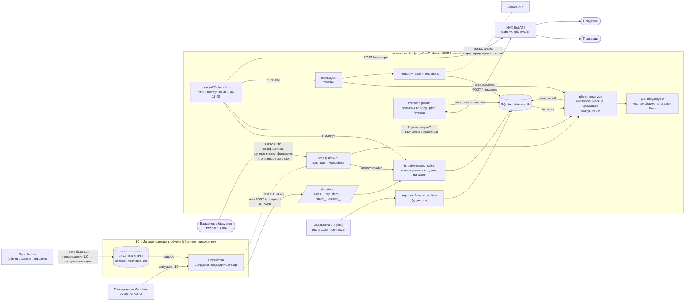
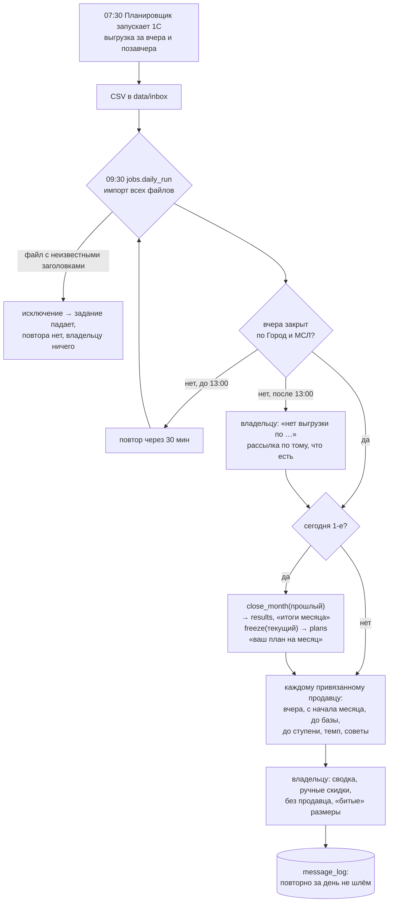
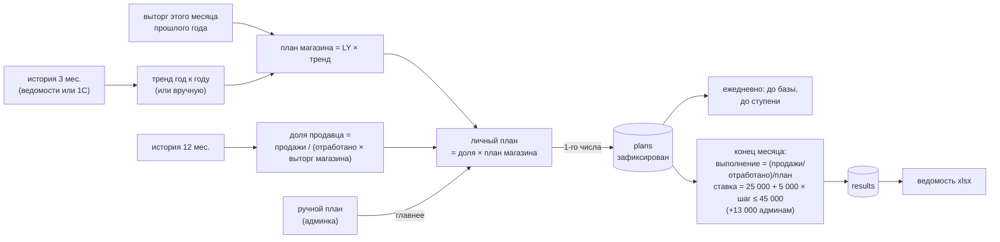

# Архитектура awer-sales-bot

Состояние на 18.10.2026. Схемы — Mermaid (GitHub рисует их сам). Находки аудита со ссылками на эти блоки —
в [АУДИТ.md](АУДИТ.md).

## 1. Блоки и связи

**Процессы и потоки.** Команда `serve` (так её запускает служба) — один процесс, три потока, которые
одновременно пишут в базу:

| Поток | Что делает | С каким соединением SQLite |
|---|---|---|
| uvicorn (главный) | админка, `/api/upload` | своё (`db` из `cli.py`), но общее для всех запросов админки |
| max-bot | long polling MAX: привязка, `/plan`, `/svodka` | второе (`DB(cfg.db_path)`) |
| APScheduler | 09:30 импорт → рассылка; 1-го — итоги и фиксация | **то же, что у max-bot** — см. АУДИТ.md, В6 |

## 2. Суточный цикл

## 3. Месячный цикл и деньги

## 4. Где граница ответственности

| Граница | Кто отвечает | Что проверить при сбое |
|---|---|---|
| 1С → CSV | обработка 1С, задача Планировщика | есть ли файлы за вчера в `data/inbox` / `data/archive` |
| CSV → база | `importers/onec_sales.py` | `awer-bot import-sales` печатает строки, дни, новых продавцов |
| база → план | `planning/` | `awer-bot plan YYYY-MM` — тренд, план магазина, личные планы |
| план → сообщение | `messages.py`, `metrics.py` | `awer-bot daily --dry-run --force` |
| сообщение → MAX | `max_api.py` | таблица `message_log`, статус `error` и текст ошибки |
| MAX → продавец | привязка по коду | админка «Продавцы»: ✅ и user_id |
